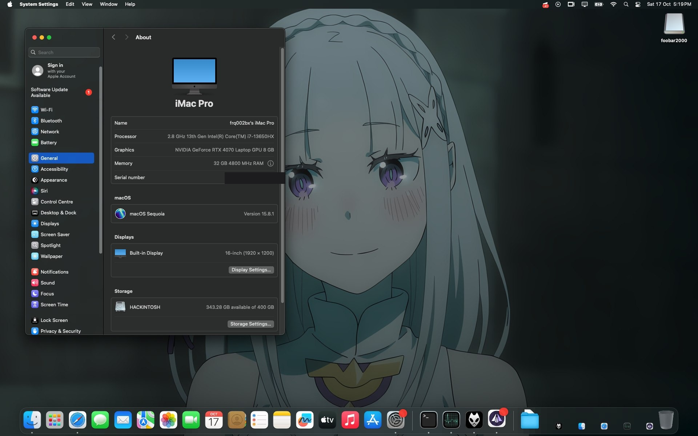

# ASUS ROG Strix G16 **G614JI** — OpenCore EFI for macOS 15 Sequoia

OpenCore **1.0.9** EFI for running **macOS 15 Sequoia** on the
**ASUS ROG Strix G16 G614JI** (i7-13650HX · RTX 4070 · 16" 1920×1200 @165 Hz).
Built and verified on this exact model.

---

## Showcase

macOS **15.8.1 Sequoia** running on the G614JI — i7-13650HX, RTX 4070 Laptop GPU (8 GB),
32 GB DDR5, 16" 1920×1200 display, installed on the `HACKINTOSH` volume.

---

## Status

| Feature | Status |
|---|---|
| Boot & install macOS 15 | ✅ working |
| Touchpad (ASUE120D) | ✅ working |
| Keyboard | ✅ working |
| Wi-Fi (Intel AX211) | ✅ working |
| Ethernet (Realtek RTL8111) | ✅ working |
| USB | ✅ working |
| Battery indicator | ✅ working |
| Audio — headphones (3.5 mm) / USB / Bluetooth | ✅ working (`alcid=24`) |
| NVIDIA RTX 4070 (NullMoth driver) | ✅ working |
| HDMI external monitor | ✅ working — connect the monitor **before** power-on |
| Brightness keys | ✅ working |
| Bluetooth (Intel AX211) | ✅ working |
| Sleep / wake | ⚠️ untested — verify in daily use |
| iMessage / iCloud | ⚠️ needs your own serials |
| **Internal speakers** | ❌ silent — CS35L41 amps over SPI, no macOS driver |
| **Fan control** | ❌ not supported — fans follow the firmware curve |

✅ working · ⚠️ untested / partial · ❌ not working

---

## Before you use it

1. **BIOS:** Above 4G Decoding **ON**, Secure Boot **OFF**, CSM **OFF**.
2. **SMBIOS:** generate your own with [GenSMBIOS](https://github.com/corpnewt/GenSMBIOS)
   (model **`iMacPro1,1`**) and put the values into `EFI/OC/config.plist` →
   `PlatformInfo > Generic` (`SystemSerialNumber`, `MLB`, `SystemUUID`, `ROM`).
   Placeholders are in there now — don't use them as-is.
3. Copy the `EFI/` folder to the root of a FAT32 partition / USB stick.
4. **GPU:** macOS boots with the RTX 4070 as an unaccelerated stub. Install the
   [NullMoth NVIDIA driver](https://github.com/nullmoth/nvidia-macos-driver) to
   get Metal — the installer edits the config it booted from and adds picker
   entries to remove itself again.
5. Install macOS 15 with a matching recovery image (e.g. `macrecovery.py`) —
   this EFI works for both the installer and the installed system.

## Notes

- `EFI/OC/OpenCore.efi` is a self-built OpenCore **1.0.9**. You can swap in the
  official 1.0.9 release binary if you prefer.
- The internal speakers cannot be fixed with `alcid`/layout-id: they sit behind
  two **Cirrus Logic CS35L41** smart amps on the SPI bus (subsystem `1043:1c9f`),
  which no macOS driver supports yet. Watch
  [CirrusAudioFixup](https://github.com/hoaug-tran/CirrusAudioFixup).
- Fan control is not implemented on macOS yet, so the fans stay on the firmware
  (EC) curve.

---

## Credits

This EFI is built on the work of these people and projects — thank you:

- **[Acidanthera](https://github.com/acidanthera)** — [OpenCore](https://github.com/acidanthera/OpenCorePkg),
  [Lilu](https://github.com/acidanthera/Lilu),
  [VirtualSMC](https://github.com/acidanthera/VirtualSMC),
  [WhateverGreen](https://github.com/acidanthera/WhateverGreen),
  [AppleALC](https://github.com/acidanthera/AppleALC),
  [AMFIPass](https://github.com/acidanthera/AMFIPass),
  [NVMeFix](https://github.com/acidanthera/NVMeFix),
  [RestrictEvents](https://github.com/acidanthera/RestrictEvents),
  [BrightnessKeys](https://github.com/acidanthera/BrightnessKeys),
  [VoodooPS2](https://github.com/acidanthera/VoodooPS2),
  [BrcmPatchRAM](https://github.com/acidanthera/BrcmPatchRAM) (BlueToolFixup)
- **[NullMoth](https://github.com/nullmoth/nvidia-macos-driver)** — the NVIDIA RTX 4070
  Metal driver and `NullMothSafe.efi`
- **[victorwitkamp/G814JI-OpenCore](https://github.com/victorwitkamp/G814JI-OpenCore)** —
  the working VoodooI2C build for this touchpad (this was the key to making it work)
- **[VoodooI2C](https://github.com/VoodooI2C/VoodooI2C)** — I2C touchpad stack
- **[OpenIntelWireless](https://github.com/OpenIntelWireless)** —
  [AirportItlwm](https://github.com/OpenIntelWireless/itlwm),
  [IntelBluetoothFirmware](https://github.com/OpenIntelWireless/IntelBluetoothFirmware)
- **[USBToolBox](https://github.com/USBToolBox)** — USB mapping
- **[khronokernel/XHCI-unsupported](https://github.com/khronokernel/XHCI-unsupported)**
- **[hieplpvip/AsusSMC](https://github.com/hieplpvip/AsusSMC)** — ASUS EC features
- **[Mieze/RTL8111_driver_for_OS_X](https://github.com/Mieze/RTL8111_driver_for_OS_X)** — Ethernet
- **[b00t0x/CpuTopologyRebuild](https://github.com/b00t0x/CpuTopologyRebuild)**
- **[lzhoang2801/OpCore-Simplify](https://github.com/lzhoang2801/OpCore-Simplify)** —
  the EFI was initially generated with this
- **[Dortania / OpenCore Install Guide](https://dortania.github.io/OpenCore-Install-Guide/)**
- **[hoaug-tran/CirrusAudioFixup](https://github.com/hoaug-tran/CirrusAudioFixup)** —
  experimental CS35L41 internal-speaker work (not solved yet)
